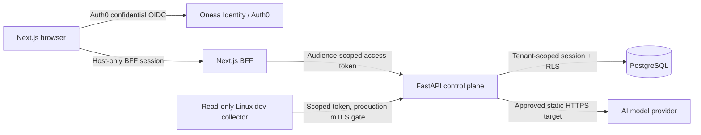

# Onesa Security

**Onesa UG · defensive cybersecurity platform · initial functional foundation (NOT production-qualified)**

Canonical repository: `DruHustle/onesa-security`. Protected frontend domain: `https://security.onesa.eu` (Cloudflare DNS, Vercel HTTPS and Vercel Authentication verified on 2026-11-18). Intended backend API: `security-api.onesa.eu` (**not deployed or DNS-routed**). The frontend's build being READY does **not** imply live customer protection.

## What works in this source

The first vertical slice connects signed Onesa Identity access tokens and local product memberships with a tenant-isolated PostgreSQL schema, a real data API, a server-rendered Next.js dashboard, a baseline AI inspection engine, a normalized event ingestion path, explainable detection rules, alert triage and an authorized Linux inventory preview. No fake findings are seeded into the interface. `apps/web` labels unsupported modules as planned.

| Capability | Current behavior | Limitation |
|---|---|---|
| Tenant identity | Auth0 JWT issuer/audience/signature validation, product-specific membership roles and per-request PostgreSQL RLS scope | New API audience/client/Onesa approval must be registered and tested |
| AI security | Allow/Block/Redact decisions, simple injection and credential-pattern detection, fixed approved HTTPS upstream nonstreaming proxy | Pattern matching cannot prevent all injections; no tool execution, streaming, RAG source auth or AI evaluation dashboard |
| Threat detection | Authorized collector events, deduplication, sign-in burst detection, privilege/persistence alerts and evidence IDs | No durable telemetry queue, long-term event search or proven large-scale correlation |
| Security operations | Alert queue, analyst status changes, dispositions and audit activity metadata | No automatic response or external SOC connector |
| Asset inventory | Scoped reporting, encrypted-transit requirement, credential expiry/revocation | Linux collector is **developer preview**, no OS event agent/secure updates/mTLS client certificates |
| Commercial / compliance | Module navigation and release blockers | Not enabled, no compliance certification or billing claim |

## Architecture



No application shares Onesa Identity's account database. No browser receives the upstream model API key. A user-provided organization ID is never an authorization grant. The application database role cannot bypass RLS. Production collector ingestion remains **fail-closed** until a separately verified mTLS ingress integration is built.

## Development and tests

See [developer runbook](docs/runbooks/LOCAL_DEVELOPMENT.md). Minimal offline tests:

```sh
python -m venv .venv
. .venv/bin/activate
pip install -e './services/api[test]'
(cd services/api && pytest -q)
(cd agents/linux && python -m unittest -q test_collector.py)
```

A local Docker Compose stack is in [`compose.dev.yaml`](compose.dev.yaml); it requires explicit local DB secrets and a dedicated Auth0 developer application and never publishes API/DB to the network. See `.env.example` for variable names, not secrets. Use actual signed Identity tokens for browser acceptance; the API tests use isolated subject fixtures for DB authorization checks only.

## Major entry points

- `services/api/app/main.py`: FastAPI endpoints (all writes role- or collector-scoped)
- `services/api/migrations/001_initial.sql`: versioned PostgreSQL DDL, RLS policies
- `services/api/tests/`: offline authorization/detection/guardrail integration tests
- `apps/web/`: Next.js 16 App Router + Auth0 SDK v4 server-side token BFF
- `agents/linux/`: read-only preview; not a native endpoint product
- `.github/workflows/verify.yml`: preliminary CI; lockfile and source CI are present; authenticated browser and performance qualification remain required
- `docs/security/THREAT_MODEL.md`: trusted boundaries and current security gaps
- `docs/security/RELEASE_DECISION.md`: evidence-based per-module NO-GO
- `AGENTS.md`: integration, authoring and security invariants

## Release contract

The overall release is **NO-GO** for customer production. An API unit test result is not an endpoint integration acceptance, and a successful UI build is not security approval. Local regression run: **10 API tests passed, 1 Linux unit test passed**. The initial GitHub Actions PR run failed before any job executed, but later source CI passed for main at `4bf5fe3` (run `44389541981`). This source-only success is not hosted identity, backend, or customer-production qualification.

The hosted source CI now exercises PostgreSQL row-level security using a non-bypass test role and a built restricted API container. Production still needs a dedicated Auth0 client with tested callback, actual Oracle API deployment and PostgreSQL backup/restore, verified ingress mTLS and secure collector enrollment, broader AI security evaluation, real OS-specific agent tests, audit immutability, throughput/latency benchmarks and authenticated browser qualification.

The **web-only DNS** and HTTPS host are configured behind Vercel Authentication. Do not publish the API domain, bypass access gates, enable paid services, install endpoint components, run production scans or claim regulatory compliance based on this foundation. See the release decision for scope-by-scope gates.

## Continued implementation scope (2026-11-18)

The review branch also implements source-referenced finding ingestion, analyst review, two-person non-executing remediation proposals and evidence-only compliance counts. No customer protections are implied by these screens. Apply SQL migrations `001_initial.sql` then `002_findings_and_approvals.sql` as the migration principal, with an application role that **cannot bypass RLS**, before running the API. Never let the API runtime user own the schema or execute migrations.

API endpoints added: `GET /v1/findings`, `POST /v1/collector/findings`, `POST /v1/findings/{id}/resolve`, `GET/POST /v1/remediation-proposals`, `POST /v1/remediation-proposals/{id}/decision`, `GET /v1/compliance/readiness`. Collector evidence is reported—not independent verification. Remediation approval cannot trigger a remote command. Authentication remains Onesa Identity via Auth0; membership remains application-local and requires explicit bootstrap.

Run Python tests in `services/api` with `python -m pytest -q` and the developer Linux tests in `agents/linux` with `python -m unittest -q test_collector.py test_posture.py`. Hosted CI successfully ran disposable PostgreSQL RLS and actual Docker-container readiness checks on 2026-11-18. Vercel has `AUTH0_DOMAIN`, `OIDC_AUDIENCE`, `APP_BASE_URL` and separately generated production/preview `AUTH0_SECRET` values. The dedicated `AUTH0_CLIENT_ID` and `AUTH0_CLIENT_SECRET`, approved tenant, and deployed live API remain absent; the protected site cannot yet sign in a real customer or show telemetry.
