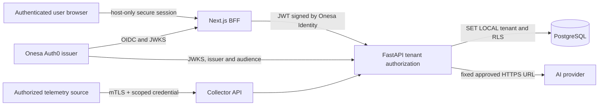

# Threat model — initial trust boundaries

## Assets and adversaries

Protected data: per-tenant assets, normalized security events, alerts, memberships, audit metadata, guardrail policies and AI content in transit. Adversaries include cross-tenant users, stolen collector credentials, untrusted documents and AI instructions, malicious browser origins, provider response injection, compromised CI dependencies and external service outages.

## Controls implemented

- Validate RS256 OIDC bearer issuer/audience/expiry before membership lookup.
- Apply per-tenant authorization at every user endpoint and PostgreSQL RLS predicates for all tenant tables; role checks on writes.
- Separate collector token path, hashed storage, expiry, revocation, idempotency and organization-scoped event records.
- Refuse privileged tool calls; heuristically inspect messages, detect likely secrets, redact simple emails; never claim comprehensive detection.
- Whitelist browser proxy paths, enforce Origin for mutations and keep upstream access credentials server-side.
- Record operation metadata, not raw prompts or credentials. Version guardrail policy with optimistic-concurrency checks.

## Explicit gaps and attack surfaces

This foundation has not undergone external penetration testing. The displayed SQL migration has not been validated with a real PostgreSQL RLS role. An end-to-end mTLS ingress is not commissioned. The Python preview collector is not a privileged or tamper-resistant endpoint agent. Agent tool privilege escalation and retrieved-content permissions have no executor and are fail-closed. Detection rule version storage, backpressure, durable queues, retention partitioning, audit chain anchoring, encrypted evidence, signed binary distribution, and full CSP qualification remain incomplete. No automated patching or critical-OT action is offered. Production release is NO-GO until each applicable gap is reviewed and tested.
